<div align="center">

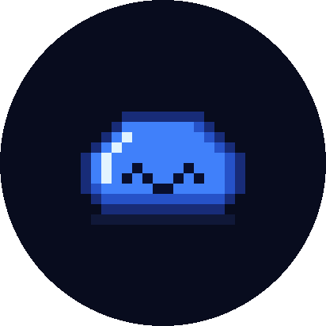

# bixo-esp32

**Bixo es una mascota virtual con IA que vive en un [SenseCAP Watcher](https://www.seeedstudio.com/watcher).**<br>
Le hablas, te contesta, te mira con su cámara y pone caras.


 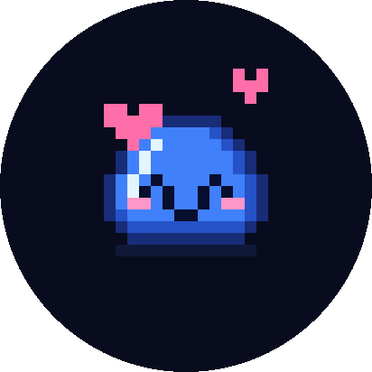 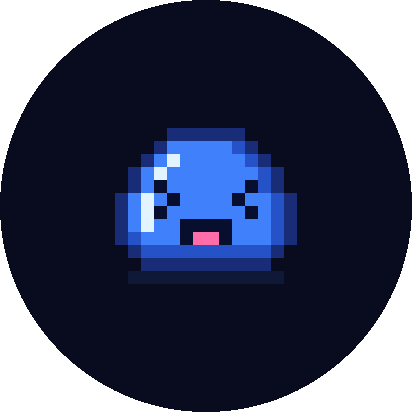 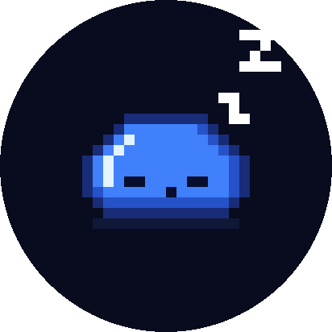 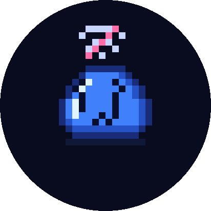

</div>

Aquí está Bixo entero:

- **El cuerpo:** el firmware del Watcher, con micrófono, altavoz, pantalla redonda, rueda,
  pantalla táctil y cámara. Es un fork de [xiaozhi-esp32](https://github.com/78/xiaozhi-esp32)
  recortado a esta única placa.
- **El cerebro,** en [`server/`](server): el servidor de voz con IA, y los sprites y fondos
  que se graban en el Watcher.

## Cómo es

### Solo Bixo en pantalla

Sin hora, sin iconos. Bixo aparece centrado y lo que le pasa al aparato se le nota a él:

| Batería llena | Menos del 50 % | Menos del 35 % | Menos del 20 % | Casi sin batería |
|:---:|:---:|:---:|:---:|:---:|
|  | 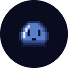 | 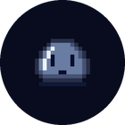 | 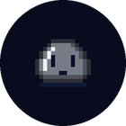 | 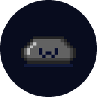 |

Sin conexión, busca el wifi con un icono tachado sobre la cabeza. Si le tocas, reacciona:
contento, enamorado o muerto de risa si insistes. Mientras habláis tampoco hay textos de
estado: mientras conecta le salen ondas de la cabeza, cuando escucha gira la cara para oírte,
con la boca en «o», y si algo falla le sale una cruz roja encima. Solo se ven los subtítulos, en pixel art como todo lo demás.

### Fondos

Detrás de Bixo hay un fondo a elegir: noche (el de siempre), blanco, prado, mazmorra,
synthwave, navidad, verano y otoño. Casi todos se mueven un poco (copos, olas, antorchas,
hojas…). Se cambia desde el menú, girando la rueda con el fondo a la vista, o pidiéndoselo a
Bixo, y se queda guardado.

### La rueda y el menú

| Volumen | Menú | Brillo |
|:---:|:---:|:---:|
| 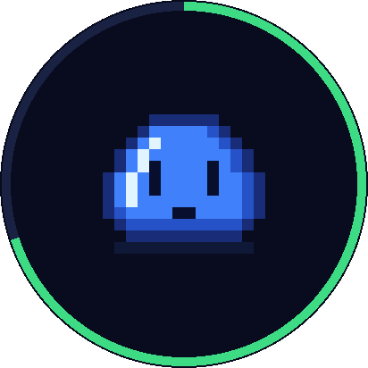 | 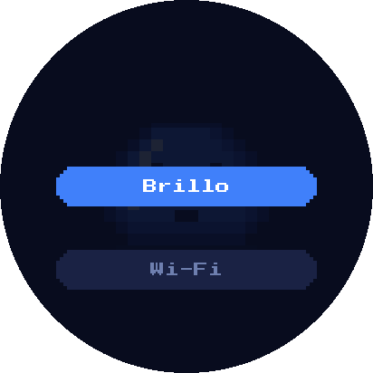 | 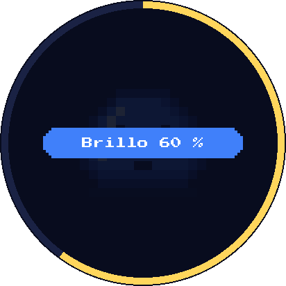 |
| Gira la rueda: un aro verde en el borde, lleno al 100 %. | Mantén el dedo en la pantalla. Se maneja con la rueda o tocando. | Un aro amarillo mientras lo ajustas. |

- **Doble pulsación** de la rueda: abre una conversación o la cierra.
- **Una pulsación:** si escucha, envía lo que has dicho; si no, empieza a escuchar. Sin
  conexión, vuelve a buscar el wifi en ese momento.
- **Un error** se quita solo a los pocos segundos, o antes tocando la pantalla o la rueda.
- **Menú:** Brillo, Fondo, Nueva charla (olvida la conversación; lo que recuerda de ti se
  queda), Wi-Fi, Reconectar wifi, Cambiar wifi, Estado, Reiniciar, Apagar y Salir.
- **La cámara** se usa hablando: «¿qué ves?», «mira esto»… El modelo decide cuándo hacer la
  foto.
- **No hay palabra de activación:** la conversación se abre con la rueda.

### Todas sus caras

<div align="center">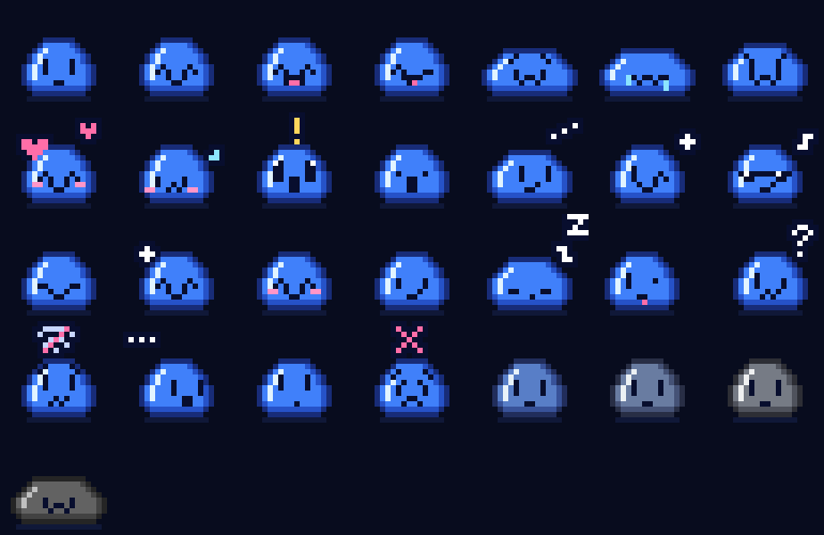</div>

Cada expresión tiene además tres versiones grises para la batería. Las animaciones y los
fondos van en la partición `assets`, que se genera en `server/`.

## Qué cambia respecto a xiaozhi

Todo lo propio está en [`main/boards/sensecap-watcher/`](main/boards/sensecap-watcher):

| Fichero | Qué hace |
|---|---|
| `sensecap_watcher.cc` | La placa: pantalla de mascota, táctil, rueda y menú |
| `pet_ui.cc` / `pet_ui.h` | El aro de nivel y el menú |
| `pet_background.cc` / `pet_background.h` | Los fondos: los pinta por celdas y solo repinta las que cambian |
| `font_pixel_16.c` | Press Start 2P a 16 px, la fuente de todos los textos |

Fuera de esa carpeta (y de `server/`) solo cambia `Application::ToggleConversation()` (abrir o
cerrar la conversación con la rueda). Del resto se han quitado las otras placas, los idiomas que no son
español o inglés, la documentación y las herramientas que el Watcher no usa.

## Compilar

`server/tools/build_firmware.sh` lo hace todo apuntando al servidor (ver
[`server/README.md`](server/README.md)). A mano, con ESP-IDF 6.1 o su imagen de Docker:

```bash
docker run --rm --platform linux/arm64 -e OTA_URL -v "$PWD:/project" -w /project \
  espressif/idf:release-v6.1 bash -c '. $IDF_PATH/export.sh && python3 scripts/build.py'
```

`OTA_URL` es la dirección OTA del servidor de Bixo: el Watcher la consulta al arrancar y
de ahí recibe la URL del WebSocket y su token. Se pasa por el entorno y solo se escribe en
`build/`, nunca en un fichero del repositorio. Con `--language en-US` compila en inglés.

## Grabar

```bash
esptool --chip esp32s3 -p PUERTO -b 230400 write-flash --flash-mode dio --flash-freq 80m \
  --flash-size 32MB 0x200000 build/xiaozhi.bin 0xa00000 server/sprites/assets.bin
```

`server/sprites/assets.bin` es la partición `assets` (sprites y fondos), que genera
`server/sprites/pack_assets.py`.

> [!WARNING]
> No grabes una imagen completa del flash: borraría `nvsfactory` (`0x9000`), donde están
> los datos de fábrica del Watcher.

## Traer cambios de xiaozhi

```bash
git remote add upstream https://github.com/78/xiaozhi-esp32.git
git fetch upstream
git merge upstream/main
```

Los conflictos son siempre de dos tipos:

- **Ficheros de placas o idiomas que aquí no existen:** se resuelven dejándolos borrados.
- **Placas o idiomas nuevos** en `main/CMakeLists.txt` y `main/Kconfig.projbuild`: se
  descartan esas líneas.

## Licencia

MIT, como xiaozhi-esp32 ([`LICENSE`](LICENSE)). La fuente Press Start 2P es de The Press
Start 2P Project Authors, con licencia SIL Open Font License
([`PressStart2P-OFL.txt`](main/boards/sensecap-watcher/PressStart2P-OFL.txt)). Las capturas
de la pantalla son simulaciones generadas con los mismos sprites, colores y fuente que el
firmware.
